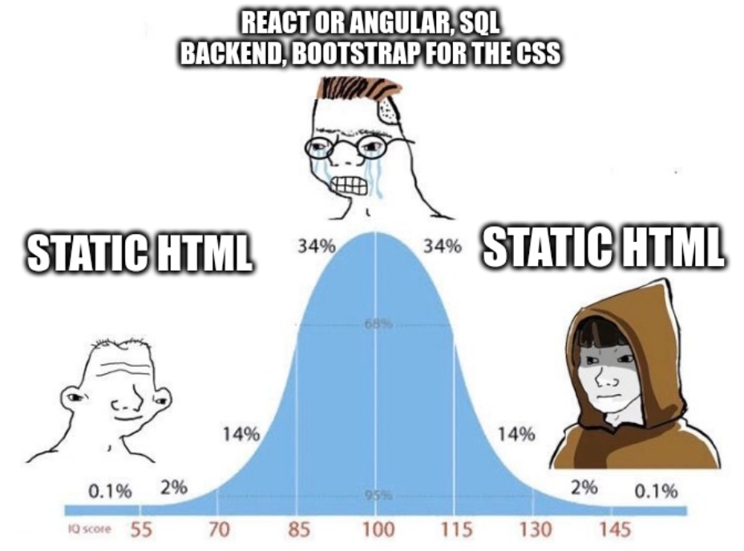

# Personal Portfolio

My portfolio website: who I am, where I've worked, what I studied and what I've built.

It is a small static site with four pages (Home, Experience, Education, Projects) and a detail page per project. Navigation never reloads the page: a title bar sweeps across, names the page you're heading to, opens to cover the screen, then lifts to reveal it.

## Tech stack

- [Astro](https://astro.build) — static site generation and the font/image pipeline
- [Tailwind CSS v4](https://tailwindcss.com) — styling, plus custom CSS in `src/styles/global.css`
- [Barba.js](https://barba.js.org) — page transitions without full reloads
- [GSAP](https://gsap.com) (with SplitText and CustomEase) — all animation

## Why Astro

I chose Astro for fast loading on a static site. It renders pages to plain HTML at build time and ships no JavaScript by default, so nothing slows a page down unless I opt in to it. Components only hydrate if given a `client:*` directive, and this site uses none.

A heavier single-page-app framework would have been overkill for a handful of static pages:



<sub>Meme via [@ploum@mamot.fr](https://mamot.fr/@ploum/113044736819173509)</sub>

The JavaScript it does ship is deliberate: the page transitions and animations (Barba.js and GSAP) are loaded through `src/scripts/animation.js` from the shared layout, so they run on every page. Everything else is static HTML and CSS.

## Getting started

Requires Node.js 22.12 or newer.

```sh
npm install
npm run dev      # dev server at http://localhost:4321
npm run build    # production build into dist/
npm run preview  # serve the production build locally
```

## Project structure

```
src/
├── layouts/
│   ├── Layout.astro           # Shell: header, menu, footer, transition overlay
│   └── ProjectsLayout.astro   # Shell for a project detail page (adds "Back to Projects")
├── pages/
│   ├── index.astro            # Home
│   ├── experience.astro
│   ├── education.astro
│   └── projects/
│       ├── index.astro        # Project cards
│       └── kimberly.astro     # Project detail page
├── components/
│   ├── TransitionOverlay.astro  # The cover used by the intro and page transitions
│   └── scrollspy.astro          # Placeholder the pagination dots are rendered into
├── scripts/
│   ├── animation.js           # Menu, intro, page transitions, content entrances
│   ├── scrollspy.js           # Pagination dots for snap-scrolling pages
│   └── utils.js               # Page list and path helpers
├── styles/global.css          # Colour tokens, frame, menu, cards, dots
├── images/                    # Photos and screenshots (optimised by Astro)
└── assets/                    # SVG icons
```

## How it fits together

**The shell is persistent.** Everything in `Layout.astro` outside the `data-barba="container"` element (header, menu, footer, overlay) stays mounted between pages. Barba swaps only the container, so anything that should survive navigation belongs outside it.

**One list drives the navigation.** `PAGES` in `src/scripts/utils.js` is the source for the menu links, the page label in the header and the counter in the footer.

**Transition titles come from the URL.** `/projects/kimberly` becomes "Kimberly" and `/` becomes "Home", so new pages need no extra configuration.

**Entrance animations are opt-in by class.** Add these to elements inside a page:

| Class           | Effect                                                            |
| --------------- | ----------------------------------------------------------------- |
| `hero-image`    | Card rises in when it enters the viewport, its children staggered |
| `hero-text`     | Fades and rises in                                                |
| `hero-title`    | Letters rise in one by one                                        |
| `hero-portrait` | Opens from a circle (wrap an image in it)                         |
| `card-hover`    | Lifts on hover with a soft light that follows the pointer         |

**Pagination dots are automatic.** Give a scrolling wrapper the class `scroll-container`, put each screen in a `<section>`, and include `<Scrollspy />`. Dots appear when there is more than one section, and the active one stretches into a pill.

## Inspiration

- [matthewao.com/work](https://matthewao.com)
- [Page Transitions in Astro with Barba.js & GSAP — "Team" demo](https://page-transitions-astro-barba-gsap.crnacura.workers.dev)
